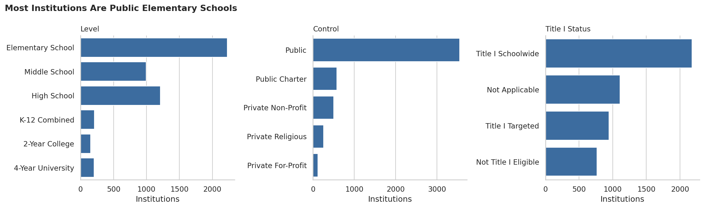
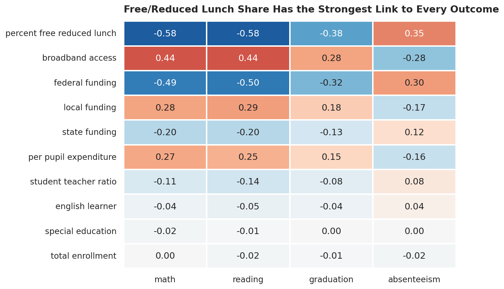
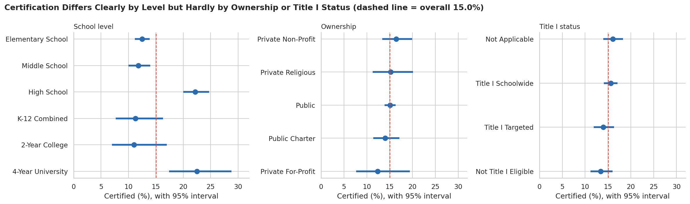
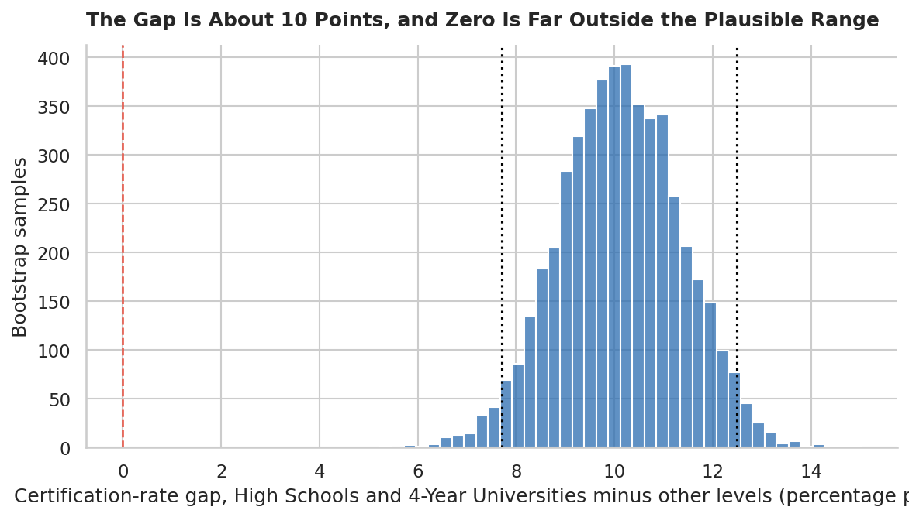
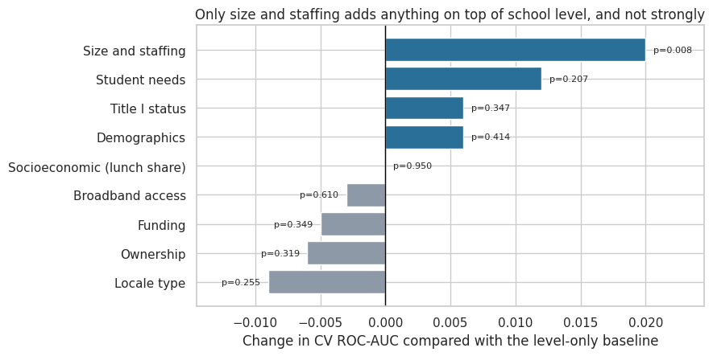
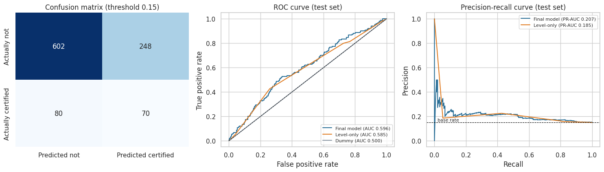
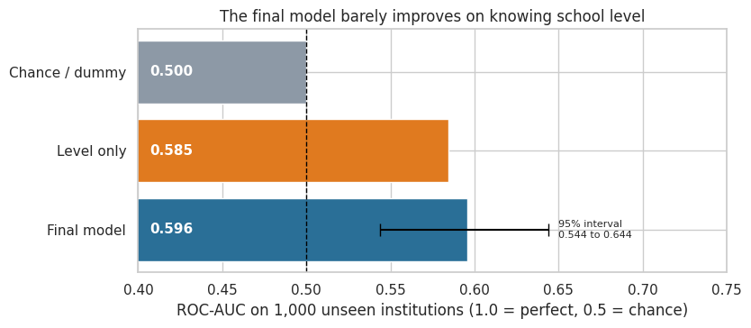

# 🎓 Education Insights Lab: Predicting STEM Certification from Institutional Characteristics

> **AltSchool Africa — 4th Semester Final Capstone Project**  
> **Student:** Nkobie Chinedu Emmanuel | **ID:** ALT/SOD/TIN/025/0168

---

## 📋 Table of Contents

1. [Project Overview](#-project-overview)
2. [Business Problem](#-business-problem)
3. [Research Questions](#-research-questions)
4. [Dataset](#-dataset)
5. [Project Structure](#-project-structure)
6. [Methodology & Workflow](#-methodology--workflow)
7. [Key Findings](#-key-findings)
8. [Model Performance](#-model-performance)
9. [Visualisations](#-visualisations)
10. [Recommendations](#-recommendations)
11. [How to Run](#-how-to-run)
12. [Dependencies](#-dependencies)
13. [Limitations & Next Steps](#-limitations--next-steps)
14. [Author](#-author)

---

## 🔍 Project Overview

This project investigates whether **STEM certification** in US educational institutions can be predicted from their observable characteristics — such as school level, ownership type, staffing ratios, funding, demographic profiles, and broadband access.

Using a dataset of **5,000 US institutions** (K-12 schools and colleges), the project walks through a full data science pipeline: from exploratory data analysis and rigorous statistical testing to machine learning modelling and actionable recommendations for a stakeholder organisation.

> **Key takeaway:** School level is the dominant signal — High Schools and 4-Year Universities are certified at roughly 22%, while other levels sit at 11–12.5%. Resource, demographic, and funding characteristics add little predictive value beyond level alone.

---

## 💼 Business Problem

An education-focused organisation holds a dataset of US institutions annotated with school-level characteristics and STEM certification status (`stem_certified_flag`). They want to know:

- **Can they identify** STEM-certified institutions from the data they already have?
- **Which characteristics** (resources, staffing, technology access, etc.) are most associated with certification?
- **Where are predictions unreliable**, signalling where better or additional data is needed?

> ⚠️ **Important:** This analysis identifies statistical associations only. It does not decide which schools *deserve* certification or establish causal relationships.

**Stakeholder:** Education-focused organisations comparing institutional patterns to guide further analysis or planning.

---

## ❓ Research Questions

| # | Question |
|---|----------|
| 1 | How common is STEM certification, and how does it vary by school level and ownership? |
| 2 | Is STEM certification statistically associated with Title I status? |
| 3 | Which characteristics contribute most to the model's predictions? |
| 4 | How reliably does the model identify certified vs non-certified institutions, and what errors does it make? |
| 5 | Does model performance differ across school levels or ownership types? |

---

## 📊 Dataset

**File:** `us_education_system_dataset.csv`  
**Shape:** 5,000 rows × 35 columns | Each row = one institution

### Feature Groups

| Group | Columns | Purpose |
|-------|---------|---------|
| **Identifiers** | `institution_id`, `institution_name`, `state_code`, `state_name`, `county` | Row key / location context — not model features |
| **Categorical** | `nces_locale`, `level`, `control`, `title_i_status` | Structural / context features |
| **Numerical (25)** | Enrollment, staffing, demographics, funding, outcomes, broadband | Potential model features |
| **Target** | `stem_certified_flag` (Yes / No) | Binary classification target |

### Key Column Reference

| Column | Type | Description |
|--------|------|-------------|
| `level` | Categorical | School level (Elementary, Middle, High School, K-12 Combined, 2-Year College, 4-Year University) |
| `control` | Categorical | Ownership (Public, Public Charter, Private Non-Profit, Private Religious, Private For-Profit) |
| `title_i_status` | Categorical | Title I classification (Schoolwide, Targeted, Not Title I Eligible, Not Applicable) |
| `percent_free_reduced_lunch` | Numerical | Socioeconomic proxy — share on free/reduced-price lunch |
| `per_pupil_expenditure_usd` | Numerical | Spending per pupil (USD) |
| `math_proficiency_pct` | Numerical | % students proficient in mathematics |
| `avg_sat_score` | Numerical | Average SAT score (67.5% missing — structurally absent outside High School / University) |
| `broadband_access_pct` | Numerical | % with broadband internet access |
| `stem_certified_flag` | **Target** | STEM-certified? (Yes = 1, No = 0) |

> **Class balance:** ~15% of institutions are STEM-certified (750 of 5,000), making this an **imbalanced classification** problem.

For the full data dictionary, see [`data_dictionary (1).csv`](data_dictionary%20(1).csv).

---

## 📁 Project Structure

```
AltSchool-Africa-Capstone-Project/
│
├── 📓 AltSchool_Final_capstone__project.ipynb   # Main analysis notebook (292 cells)
│
├── 📄 Altschool_Capstone_Report.pdf             # Written project report (PDF)
├── 📄 Altschool_Capstone_Report.docx            # Written project report (Word)
│
├── 📂 Data Files
│   ├── us_education_system_dataset.csv           # Raw dataset (5,000 institutions)
│   ├── data_dictionary (1).csv                  # Column descriptions and expected use
│   ├── cleaning_log.csv                         # Decisions made during data cleaning
│   ├── model_cv_results.csv                     # Cross-validation results for all models
│   ├── model_test_results (1).csv               # Final held-out test set results
│   └── statistical_results (1).csv              # All hypothesis test statistics
│
├── 📂 Visualisation Outputs (PNG)
│   ├── 01_categories.png                        # Categorical feature distributions
│   ├── 02_univariate.png                        # Univariate numerical distributions
│   ├── 03_drivers_vs_math.png                   # Resource drivers vs math proficiency
│   ├── 04_correlation_heatmap.png               # Feature correlation heatmap
│   ├── 05_lunch_band_outcomes.png               # Lunch share & broadband vs outcomes
│   ├── 06_title_i.png                           # Title I status breakdown
│   ├── 07_certification_by_category.png         # Certification rates by category
│   ├── 08_certification_quartile_spread.png     # Certification across quartiles
│   ├── 09_multivariate_math.png                 # Multivariate math proficiency analysis
│   ├── 10_level_by_control.png                  # Level distribution by ownership
│   ├── 12_level_pairwise.png                    # Pairwise level comparisons
│   ├── 13_level_gap_bootstrap.png               # Bootstrap CI for level gap
│   ├── 14_category_associations.png             # Chi-square association summary
│   ├── 15_numeric_characteristics_auc.png       # AUC for numeric predictors
│   ├── 16_partial_correlations.png              # Partial Spearman correlations
│   ├── 20_interpretation.png                    # Model coefficient interpretation
│   ├── certification_story.png                  # Certification narrative summary
│   ├── feature_group_gain.png                   # Feature group AUC gain over baseline
│   ├── model_shortlist.png                      # Model shortlist comparison chart
│   ├── model_value.png                          # Business value analysis
│   └── test_performance.png                     # Final model test performance
│
└── README.md                                    # This file
```

---

## 🔬 Methodology & Workflow

The project follows a structured, reproducible data science workflow across **five phases**:

```
Phase 1          Phase 2            Phase 3             Phase 4            Phase 5
─────────        ───────────        ────────────        ────────────       ────────────
Structure    →   Univariate     →   Bivariate &     →   Modelling      →   Conclusions
the Data         Analysis           Multivariate        & Evaluation       & Actions
                                    Analysis
```

### Phase 1 — Data Understanding & Cleaning

- Loaded 5,000 × 35 dataset; classified columns into identifiers, categorical, and numerical
- Investigated 4 columns with structural missingness (SAT/ACT, AP/IB, postsecondary) — missing values align perfectly with institution level, so they were **retained as missing** (not imputed)
- Ran 15 validity checks — zero violations found
- Noted ceiling effects (broadband 99%, graduation 99.5%, spending \$7,500) in 0.7–4.5% of rows — retained
- Added helper columns: `institution_group` (K-12 vs college), `readiness_coverage`, and binary `is_certified` (1/0)
- **Zero rows removed** — all cleaning decisions logged in [`cleaning_log.csv`](cleaning_log.csv)

### Phase 2 — Univariate Analysis

- Distribution plots for all 25 numerical features
- Category counts for 5 categorical features
- Identified the **15% STEM certification rate** (750 / 5,000 institutions)
- School mix: Elementary 44.5%, High School 24.2%, Middle 19.9%, K-12 Combined 4.2%, colleges 7.2%

### Phase 3 — Bivariate & Multivariate Analysis

**Statistical tests performed:**

| Test | Variables | Key Result |
|------|-----------|------------|
| Chi-square | Certification vs School Level | χ² = 81.64, p < 0.001, Cramér's V = 0.128 ✅ |
| Chi-square | Certification vs Ownership | χ² = 1.89, p = 0.757, Cramér's V = 0.019 ❌ |
| Chi-square | Certification vs Title I | χ² = 3.76, p = 0.288, Cramér's V = 0.027 ❌ |
| Chi-square | Certification vs Locale | χ² = 4.80, p = 0.684, Cramér's V = 0.031 ❌ |
| Mann-Whitney U (×12) | Numeric features vs certification (level-adjusted) | 0 of 12 significant after correction ❌ |
| Bootstrap interval | High School + University vs other levels | Gap = 10.1 pp (95% CI 7.7–12.5) ✅ |
| Partial Spearman | Spending vs math proficiency | ρ = 0.178 (95% CI 0.151–0.205) ✅ |
| Partial Spearman | Broadband vs math proficiency | ρ ≈ 0.000 ❌ |

### Phase 4 — Modelling

**Target:** `is_certified` (binary, 15% positive class)  
**Evaluation metrics:** ROC-AUC (primary), PR-AUC, Accuracy, Precision, Recall, F1  
**Validation:** Stratified 5-fold cross-validation on training set; final evaluation on held-out test set

**Models evaluated (13 total across two rounds):**

| Stage | Models Tried |
|-------|--------------|
| Round 1 | Dummy classifier, Level-only logistic (baseline), Full logistic regression, Balanced logistic, Decision tree (depth 4), Random forest (defaults & tuned), Gradient boosting (shallow) |
| Tuning round | Reduced logistic (level + size/staffing), Soft-voting ensemble (LR + RF + GB), Tuned logistic, Tuned gradient boosting, Tuned random forest |

**Winner:** Reduced Logistic Regression using only `level` + size/staffing features — achieves the best CV ROC-AUC (0.590) with the smallest number of features and no overfitting.

### Phase 5 — Interpretation & Recommendations

- Feature group gain analysis shows size/staffing adds +0.020 AUC over level alone
- All other feature groups (demographics, funding, outcomes, broadband) add ≤ 0.006 AUC
- Model coefficients interpreted as odds ratios, not causal effects

---

## 📈 Key Findings

### Finding 1 — School level is the only clear pattern

| Level | Certification Rate |
|-------|--------------------|
| High School | 22.2% |
| 4-Year University | 22.5% |
| K-12 Combined | ~12% |
| Middle School | ~11% |
| Elementary | ~11% |
| 2-Year College | ~11% |

The bootstrap-confirmed gap between (High School + University) and other levels is **10.1 percentage points (95% CI: 7.7 to 12.5)**.

### Finding 2 — Resource, demographic and funding features add no meaningful signal

After correcting for multiple comparisons, **0 of 12** numeric characteristics (enrollment, proficiency rates, funding shares, broadband access, etc.) show a statistically significant difference between certified and non-certified institutions.

### Finding 3 — Spending correlates with math proficiency, not certification

- Partial Spearman ρ = **0.178** (spending → math proficiency, controlling for lunch share)
- Broadband access, federal funding share, and student-teacher ratio show **ρ ≈ 0** in the same framework

### Finding 4 — Certification is not concentrated in higher-need schools

Title I status and ownership type show no significant association with certification (p = 0.288 and p = 0.757, respectively), suggesting certification is spread roughly evenly across socioeconomic contexts.

---

## 🤖 Model Performance

### Cross-Validation Results (Training Set)

| Model | CV ROC-AUC | SD | CV PR-AUC | ΔvS Baseline |
|-------|------------|-----|-----------|--------------|
| Dummy (always base rate) | 0.500 | 0.000 | 0.151 | -0.067 |
| Level-only logistic *(baseline)* | 0.567 | 0.028 | 0.183 | — |
| **Reduced logistic (level + size/staffing)** | **0.590** | **0.029** | **0.213** | **+0.023** |
| Soft-voting ensemble | 0.581 | 0.031 | 0.206 | +0.014 |
| Tuned logistic | 0.580 | 0.033 | 0.207 | +0.013 |
| Tuned gradient boosting | 0.579 | 0.027 | 0.202 | +0.012 |

### Final Test-Set Results

| Model | ROC-AUC | PR-AUC | Precision | Recall | F1 | Flagged |
|-------|---------|--------|-----------|--------|----|---------|
| Dummy (base rate) | 0.500 | 0.150 | 0.000 | 0.000 | 0.000 | 0% |
| Level-only logistic | 0.585 | 0.185 | 0.225 | 0.427 | 0.295 | 28.4% |
| **FINAL: Reduced logistic** | **0.596** | **0.207** | **0.220** | **0.467** | **0.299** | **31.8%** |

> **In plain terms:** Flagging 318 institutions produced ~70 correct identifications and ~248 false alarms. The model is a rough screening aid only, not a decision-making tool.

---

## 🖼️ Visualisations

| Plot | Description |
|------|-------------|
|  | Categorical feature distributions |
|  | Feature correlation heatmap |
|  | Certification rates across school categories |
|  | Bootstrap confidence interval for the level certification gap |
|  | AUC gain per feature group over level-only baseline |
|  | Final model test-set performance summary |
|  | Business value framing of model outputs |

---

## ✅ Recommendations

### 1 — Use school level as the primary filter for identifying likely-certified institutions

**Evidence:** Level alone achieves ROC-AUC = 0.585; High School and 4-Year University show 22% certification vs 11–12.5% elsewhere.  
**Action:** Any targeting or analysis should stratify by school level first.

---

### 2 — Do not use this model to rank institutions for support or funding decisions

**Evidence:** 0 of 12 resource/demographic features significant after correction; within-level AUC ≈ 0.489 (near chance).  
**Action:** At most, use model scores as a rough preliminary screen. Document false-alarm costs before deployment.

---

### 3 — Examine whether certification reaches high-need schools, using better data

**Evidence:** Title I p = 0.288 after level adjustment; certification rates 13.4%–16.1% across Title I groups.  
**Action:** Add data on what certification involves (STEM courses, labs, teacher qualifications, year certified) before drawing equity conclusions.

---

### 4 — Test the size and staffing signal on new data before acting on it

**Evidence:** Size/staffing adds +0.020 AUC over level alone (corrected p = 0.072, borderline); test-set gain was +0.011 (95% CI –0.030 to +0.055).  
**Action:** Treat as an unconfirmed hypothesis; validate on a fresh year or sample.

---

### 5 — Prioritise per-pupil spending in future studies of academic outcomes

**Evidence:** Partial Spearman ρ = 0.178 (spending → math proficiency); broadband and federal funding share ≈ 0.  
**Action:** If the organisation's interest extends to academic outcomes, spending is the one lead the data support.

---

## 🚀 How to Run

### Prerequisites

- Python 3.9+
- Jupyter Notebook or JupyterLab

### Quick Start

```bash
# 1. Clone the repository
git clone https://github.com/Scriptnedu/AltSchool-Africa-Capstone-Project.git
cd AltSchool-Africa-Capstone-Project

# 2. Install dependencies
pip install -r requirements.txt

# 3. Launch the notebook
jupyter notebook AltSchool_Final_capstone__project.ipynb
```

> **Note:** The notebook originally loaded data from Google Drive. Update the `pd.read_csv(...)` path in cell 9 to point to your local copy of `us_education_system_dataset.csv`.

```python
# Replace this:
us_edu_data = pd.read_csv("/content/drive/MyDrive/...")

# With this:
us_edu_data = pd.read_csv("us_education_system_dataset.csv")
```

---

## 📦 Dependencies

| Library | Purpose |
|---------|---------|
| `pandas` | Data loading and manipulation |
| `numpy` | Numerical operations |
| `matplotlib` | Plotting and visualisation |
| `seaborn` | Statistical visualisation |
| `scipy` | Statistical tests (chi-square, Mann-Whitney U) |
| `scikit-learn` | Machine learning models, pipelines, evaluation |
| `itertools` | Utility for pairwise combinations |

Install all at once:

```bash
pip install pandas numpy matplotlib seaborn scipy scikit-learn
```

---

## ⚠️ Limitations & Next Steps

### Limitations

| Limitation | Detail |
|------------|--------|
| Observational data | Results show associations only — no causal claims can be made |
| Undefined certification | The project brief does not define how STEM certification is awarded |
| Class imbalance | 15% positive class — accuracy alone is a misleading metric |
| Structural missingness | SAT/ACT, AP/IB, and postsecondary columns are absent for 67.5–71.6% of rows by design |
| Single snapshot | Data represent one point in time; patterns may not be stable across years |
| Generalisation | Results apply to this dataset; they may not extend to other institutions or regions |

### Suggested Next Steps

| Priority | Action | Why |
|----------|--------|-----|
| 🔴 1 | Add STEM programme variables (courses, labs, teacher qualifications, year certified) | Current features carry little information about certification |
| 🟠 2 | Re-test size/staffing signal on a new year of data | Only unresolved predictive lead |
| 🟡 3 | Agree on the cost of a missed institution vs a false alarm | Required to set a meaningful classification threshold |
| 🟢 4 | Repeat analysis in a later year | Tests whether the level pattern is stable over time |

---

## 👤 Author

| Field | Detail |
|-------|--------|
| **Name** | Nkobie Chinedu Emmanuel |
| **Learner ID** | ALT/SOD/TIN/025/0168 |
| **Email** | micnedu01@gmail.com |
| **Programme** | AltSchool Africa — School of Data (4th Semester) |
| **GitHub** | [Scriptnedu/AltSchool-Africa-Capstone-Project](https://github.com/Scriptnedu/AltSchool-Africa-Capstone-Project) |

---

<div align="center">

*Built as the final capstone project for the AltSchool Africa School of Data programme.*

</div>
